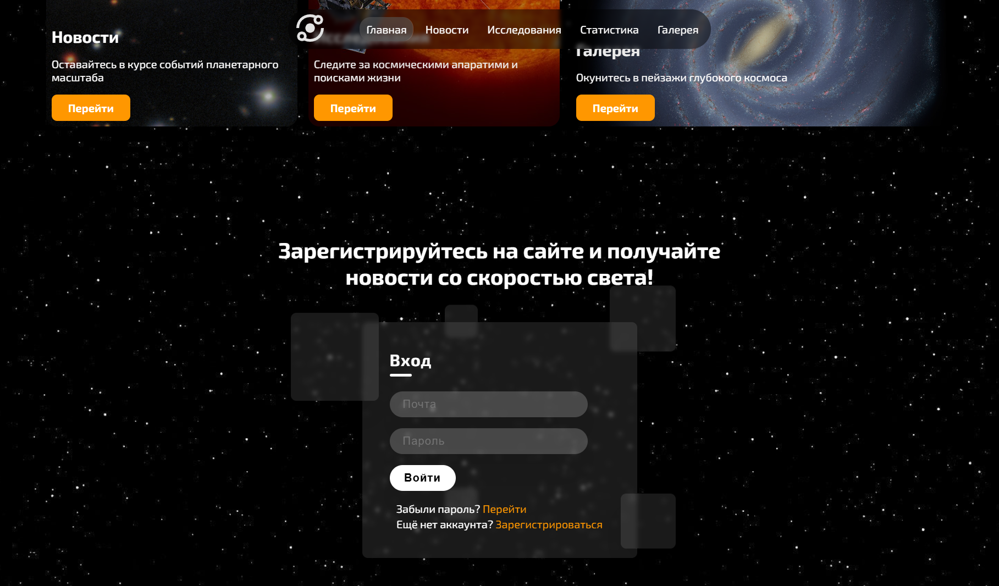
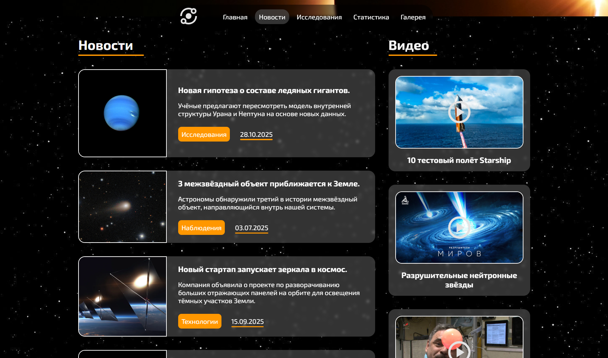
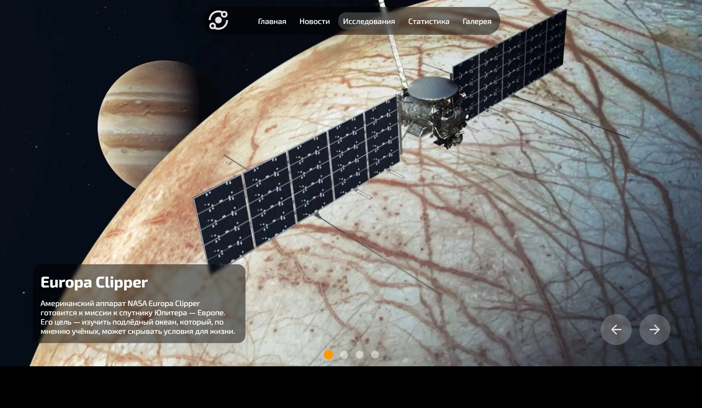
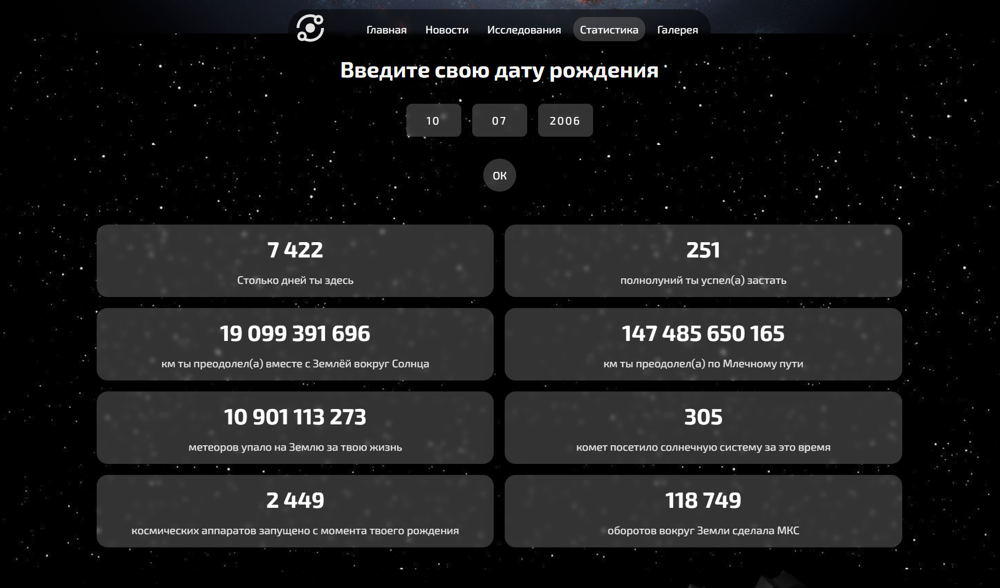
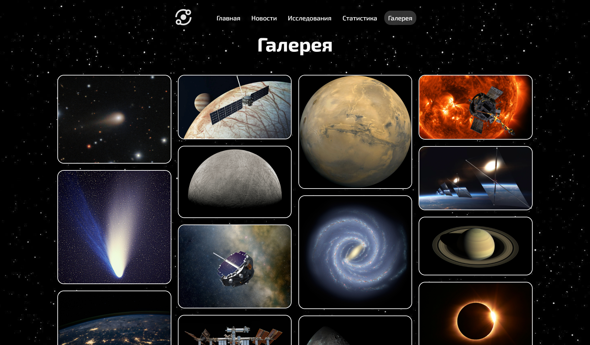

# Solar System

An informational website about the Solar System, space exploration, and astronomical events.

A university coursework project developed to practice HTML, CSS, and JavaScript without using frameworks. The website consists of five pages featuring interactive elements, animations, and responsive layouts.

## Screenshots


| News                                    | Research                                          |
|:---------------------------------------:|:-------------------------------------------------:|
|  |  |

| Statistics                                          | Gallery                                       |
|:---------------------------------------------------:|:---------------------------------------------:|
|  |  |

## Features

The website consists of five sections:

- **Home** – Introduction to the project and navigation to the main sections.
- **News** – A news feed powered by a local JSON file, with incremental loading via a "Load More" button. YouTube videos can also be viewed in a modal window.
- **Research** – An interactive spacecraft carousel and a scroll-driven section with dynamic background transitions.
- **Statistics** – Estimated space-related statistics based on the user's date of birth, countdowns to astronomical events, and dynamically updated distance counters.
- **Gallery** – A collection of images used throughout the website.

## Tech Stack

- **HTML5**
- **CSS3**
- **JavaScript (ES6+)**

The project does not use a build tool, JavaScript frameworks, or a backend.

## Getting Started

A modern web browser and a local HTTP server are required to run the website.

1. Clone the repository:

   ```bash
   git clone https://github.com/ZM854/solar-system-news-site.git
   cd solar-system-news-site
   ```

2. Start a local HTTP server, for example, using Python:

   ```bash
   python -m http.server 8000
   ```

3. Open [http://localhost:8000](http://localhost:8000) in your browser.

A local HTTP server is required to load news data from `data/news.json` using the Fetch API.
